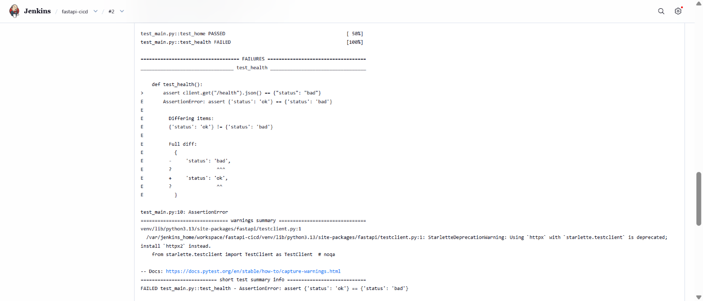
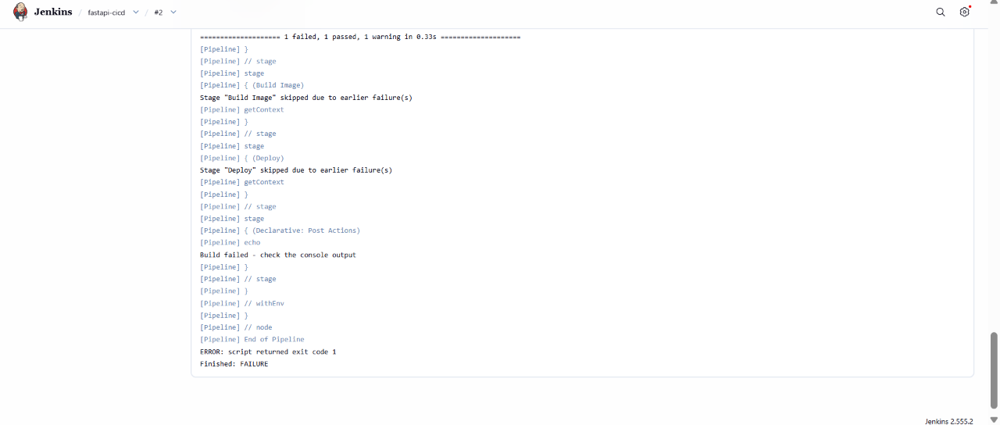
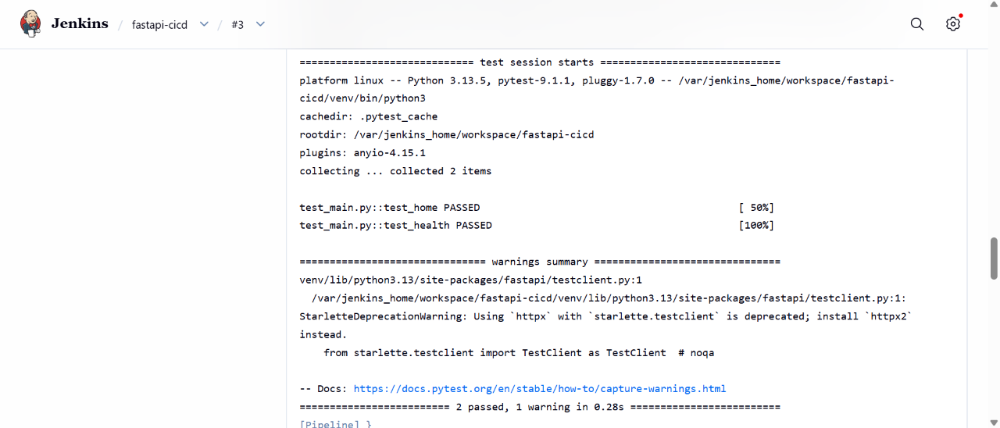
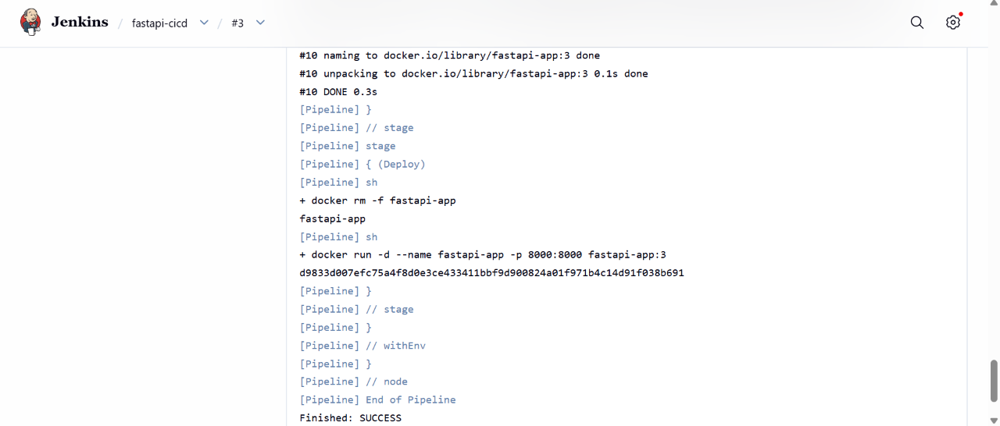
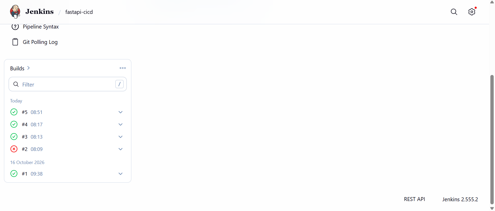
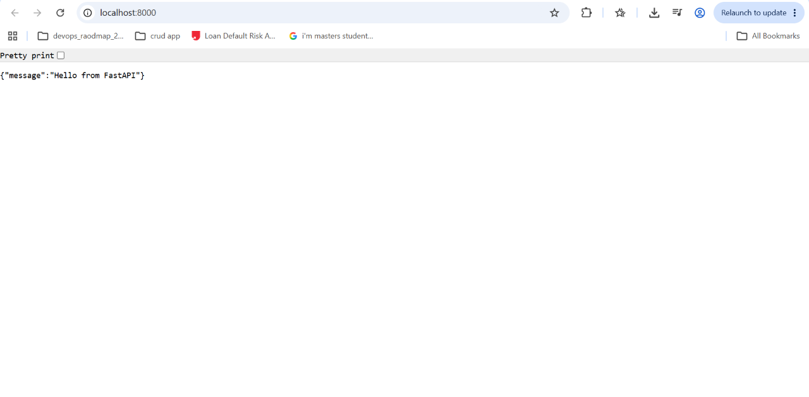

# FastAPI CI/CD Pipeline


A small FastAPI app that is tested, built into a Docker image, and deployed automatically by a Jenkins pipeline every time code is pushed to GitHub.

## What it does
- FastAPI app with two endpoints: `/` and `/health`
- Pytest tests for both endpoints
- Dockerfile that packages the app so it runs the same on any machine
- Jenkins pipeline with 4 stages: Checkout, Install and Test, Build Image, Deploy
- GitHub Actions workflow that runs the tests and builds the Docker image on every push

## Tech
Python, FastAPI, Pytest, Docker, Jenkins, Git, GitHub

## How the pipeline works
1. Jenkins pulls the code from this repo (it checks GitHub every 2 minutes).
2. It installs the requirements and runs the tests.
3. If the tests pass, it builds a Docker image tagged with the build number (for example `fastapi-app:3`).
4. It replaces the running container with the new image.

If a test fails, the pipeline stops and the build and deploy stages are skipped, so broken code is never deployed.

## Screenshots
**Failed build: the test stage stopped the pipeline**




**Successful build: tests passed, image built, app deployed**




**Build history**



**App running after deployment**



## What I tested and fixed
I broke a test on purpose to see the pipeline fail, read the console log to find the cause, fixed it, and confirmed the next build passed. Details are in [docs/incident-log.md](docs/incident-log.md).

## Run it yourself
```
docker build -t fastapi-app .
docker run -d -p 8000:8000 --name fastapi-app fastapi-app
```
Then open http://localhost:8000

Run the tests locally:
```
pip install -r requirements.txt
python -m pytest -v
```

## What I learned
- How a CI/CD pipeline connects GitHub, Jenkins and Docker
- How to read a Jenkins console log to find a failing test
- Why running tests before deploying protects the live app